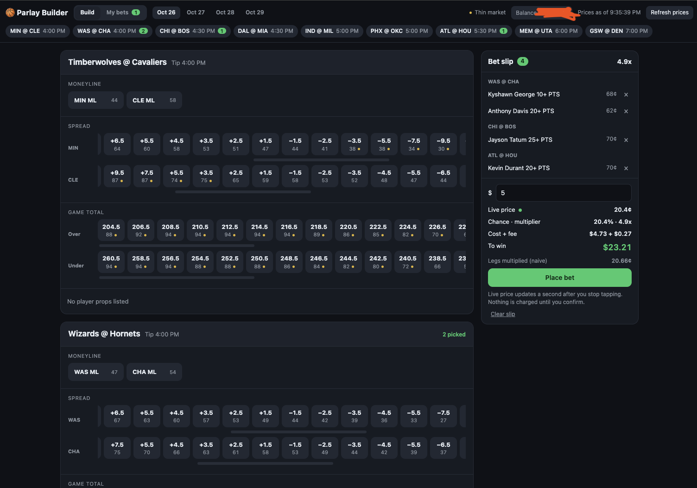

# Parlay Builder

A website that runs on your own Mac for building, placing and tracking NBA parlays on
[Kalshi](https://kalshi.com), with live player stats next to every leg.



**This places real-money bets with your Kalshi account.** Nothing is charged until you press
Confirm in the popup, which shows the exact price and total. There's no stake limit beyond
your balance.

## Setup (once, about 5 minutes)

### 1. Make a Kalshi API key

1. Log in at [kalshi.com/account/profile](https://kalshi.com/account/profile) and scroll down
   to **API Keys**. Create a key.
2. Leave the key type on **Ed25519**, and leave the public key box empty.
3. Kalshi shows a **Key ID** (copy it) and downloads a **.txt file**: your private key.
   **It's shown only once**, so keep the file until setup is done.

Anyone with that file can trade on your account. Setup copies it to a private folder on your
Mac (`~/.parlay`); it's never sent anywhere except as signatures on your own requests to Kalshi.

### 2. Install and connect

Open **Terminal** (Spotlight: ⌘ Space, type Terminal) and run:

```
git clone https://github.com/cl519/parlay-builder.git ~/parlay-builder
cd ~/parlay-builder
./parlay setup
```

- If a window asks to install the **command line developer tools**, click Install, wait for
  it, and run the command again. (It's Apple's; it brings git and Python.)
- Setup asks for the Key ID (paste it) and the key file: **drag the .txt from Finder into the
  Terminal window** and press Return.
- It then checks your balance with Kalshi to make sure the key works. When it says
  **Connected**, you can delete the downloaded .txt.

### 3. Start it

```
./parlay
```

The site opens at http://127.0.0.1:8787. Only your Mac can reach it.

| Command | What it does |
|---|---|
| `./parlay` | Start (if needed) and open the site |
| `./parlay stop` | Stop it |
| `./parlay update` | Get the latest version and restart |
| `./parlay log` | Show recent server output, if something looks wrong |
| `./parlay setup` | Connect a different API key |

## Using it

### Build

Every game today with its moneylines, spreads, totals, and player props (points, rebounds,
assists, threes...) as ladders of lines. Tap lines to add them to the slip.

- The slip gets a **live price** a second after you stop tapping: what you'd pay, the payout,
  and the chance Kalshi's market makers imply. Asking is free.
- **Place bet** holds the best price for 2 minutes in a popup. **Confirm** buys at exactly that
  price or better, or nothing at all.
- One leg = a single bet off Kalshi's order book; two or more = a parlay priced by Kalshi's
  market makers.
- Hover a player's name for his last 5 games and season averages. Small numbers under each
  line are its live price in cents (≈ the % chance).
- **Funds:** Kalshi keeps parlay money in its own bucket of your account. If the balance at
  the top says money is elsewhere, the button next to it moves it over (it stays in your account).

### My bets

Your open parlays, each leg with its live stat (e.g. 13/15 PTS, 4th quarter) and chance.

- **Tonight** line: staked, paid out, locked in (every leg won, not paid yet), net, and what's
  still riding. Net counts open parlays as $0 until they hit.
- **Borders:** red = a leg under 33%, yellow = a leg under 50%; otherwise green = parlay 50%+,
  blue = 3% or more.
- **Tap a leg** to drop it or change its line, then **Replace** to buy that version as a new
  parlay (the original keeps riding). A leg that already hit can be raised (10+ → 15+).
- **Add more** buys more of the same parlay (or, once legs have hit, the legs still to go).
  **Cash out** sells it back to the market makers at their best offer, behind the same
  confirm popup. **Use in slip** copies its legs to Build.
- Parlays asking the same questions **stack** into one card (an original and its replacements).
- "Out" = the injury report has the player out. A player who doesn't play doesn't lose the
  leg: Kalshi settles it at a fair price instead.
- Cards never jump around while you look at them; new parlays wait behind a "new parlays"
  pill, and a sort click re-sorts.

## How it works

A small Python server on your Mac (`app/server.py`) serves the page and talks to Kalshi's API,
signing each request with your key (`app/kalshi.py`). Game data comes from Kalshi's public
markets; live box scores and player game logs from ESPN's public feeds. No accounts, no
analytics, nothing else.

Safety: the server only listens on your Mac (127.0.0.1); every action that spends money needs
a per-run token that only the page has, plus localhost Host/Origin checks, so other websites
can't trigger bets.

## For developers

Python is in `app/`, the page in `web/`.

| File | Job |
|---|---|
| `server.py` | HTTP only: routes, security checks, static files |
| `kalshi.py` | Kalshi API client: request signing (Ed25519 or RSA), positions, parlay quotes |
| `betting.py` | Live pricing, placing bets (parlays via quotes, singles off the order book), cash out, balance |
| `bets.py` | Your open parlays: each leg described with its live chance; stacks |
| `nights.py` | Tonight's money from fills + settlements (pure) |
| `menus.py` | Kalshi markets → per-game menus (`assemble_games` is pure) |
| `live_stats.py` | ESPN scores + box scores, keyed by Kalshi game (`parse_box` is pure) |
| `player_log.py` | A player's last 5 games + season averages for the hover card |
| `setup_key.py` | `./parlay setup`: store and check your API key |
| `config.py`, `net.py` | Port and quote lifetime; JSON fetch for public sources |

Frontend: `state.js` (app state), `board.js` (game list), `slip.js` (slip + live price),
`place.js` (confirm flow), `bets.js` (My bets), `columns.js` + `order.js` (card layout),
`markets.js`, `names.js`, `tooltip.js`, `balance.js`, `format.js`, `api.js`, `main.js`.

My bets never rebuilds the page: background updates only patch what cards say (with
idiomorph, `web/js/vendor/`), and cards only move at a layout or when they're off screen.
Details at "Cards on the page" in `bets.js`.

```
.venv/bin/python -m unittest discover -s tests -t .   # Python
node --test web/js/tests/*.test.js                   # page logic (needs Node)
```

To try a change without touching your real slip, run a second copy on another port
(`PARLAY_PORT=8788 .venv/bin/python app/server.py`). It uses your real key, so don't confirm bets on it.

Text from Kalshi or ESPN is escaped where it's put into the page (`esc` in `format.js`).

## Credits

`app/kalshi.py` started from [yakub268/kalshi-mcp](https://github.com/yakub268/kalshi-mcp) (MIT,
`LICENSES/kalshi-mcp.txt`). idiomorph 0.7.4 (0BSD, `web/js/vendor/idiomorph.LICENSE`).
Not affiliated with Kalshi or ESPN.
